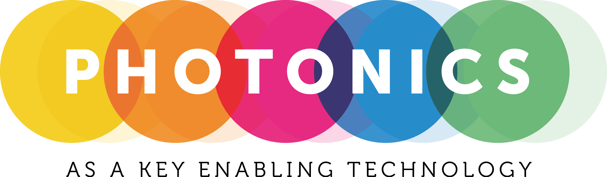

+++
title = "Photonics as a Key Enabling Technology"
date = "2026-11-26"
publishDate = "2026-10-16"

[cover]
image = "https://lh3.googleusercontent.com/d/1JrCps6XPlwZ7jBhoQHQJnwuroIHA-0S5=s1920"
alt = "Photonics as a Key Enabling Technology: Light up your Future"
relative = true
hiddenInSingle = true

[[Share]]
name = "instagram"
url = "https://www.instagram.com/p/DRebP3ejpFr"
+++

# Birthday Edition

Interested in nanomaterials, photonics, quantum technologies, biophysics or computing with light?  
Join us for two days of accessible talks, from early breakthroughs to today’s research frontiers.

**Registration for Food: [form](form/)**

📅 Date: 26 November 2026  
🕠 Time: 14:30 - 18:00  
📍 Location: Room A109, Polo Ferrari 1, via Sommarive 9, Povo (TN)

📅 Date: 27 November 2026  
🕠 Time: 08:50 -12:00 / 13:30 - 18:00  
📍 Location: Room A108, Polo Ferrari 1, via Sommarive 9, Povo (TN)

## Program



